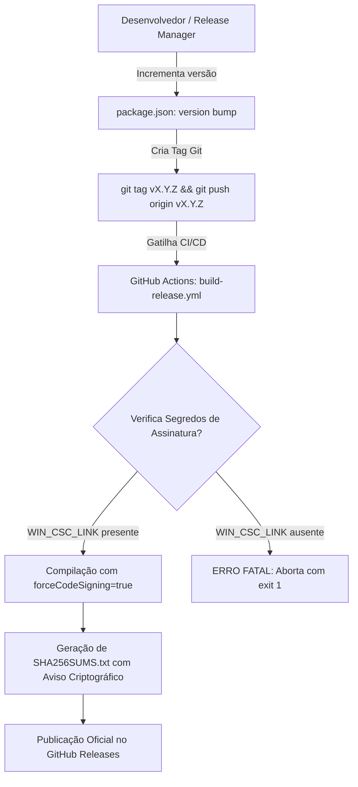
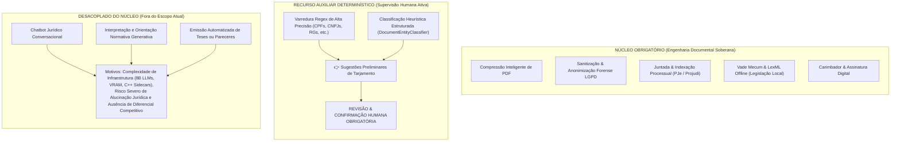

# Guia Operacional de Release, Assinatura Digital e Pré-Requisitos de Distribuição

> [!IMPORTANT]
> **AVISO DE ESCOPO E DISTINÇÃO METODOLÓGICA:**
> A suíte automatizada de testes (`npm run test:distribution-prerequisites`) realiza uma **verificação estática e declarativa de configurações, manifestos e regras de CI/CD**.
> Ela **NÃO substitui nem constitui a homologação operacional completa de ponta a ponta**. A homologação operacional definitiva requer a instalação e execução física do instalador compilado e assinado em computadores limpos (via **Windows Sandbox** ou máquinas virtuais isoladas), executada por operadores humanos ou runners dedicados equipados com certificados oficiais.

---

## 1. Fluxo de Publicação e Versionamento de Releases

O processo de publicação do **KovaxFiles Desktop** é governado por travas criptográficas estritas para impedir a distribuição de binários não homologados:



### 1.1 Regras do Pipeline Oficial
- **Tags de Release (`v*`):** A presença de certificados de assinatura digital (`WIN_CSC_LINK` no Windows e `MAC_CSC_LINK` no macOS) é **obrigatória**. A ausência de certificados aborta o pipeline com erro fatal (`exit 1`), impedindo que executáveis não assinados sejam publicados no canal oficial.
- **Workflow Dispatch Manual:** A flag `allow_unsigned_dev: true` só pode ser disparada manualmente para compilações de testes internos efêmeros, emitindo alertas explícitos no log e **nunca** publicando no GitHub Releases.

---

## 2. Validação Operacional de Assinatura pelo Sistema Operacional

### 2.1 No Windows (Microsoft Authenticode & SmartScreen)

No Windows, a integridade e autoria do instalador devem ser verificadas diretamente pelo subsistema de segurança do sistema operacional.

#### Comando Oficial de Inspeção no PowerShell:
```powershell
Get-AuthenticodeSignature .\KovaxFiles-Setup-1.0.0.exe | Format-List *
```

#### Interpretação dos Resultados pelo SO:

| Status do SO | Significado Técnico | Comportamento do Windows SmartScreen |
| :--- | :--- | :--- |
| **`Valid`** | Assinatura válida, criptograficamente íntegra e ancorada em Autoridade Certificadora Raiz confiável pelo Windows. | SmartScreen aceita o binário. Com certificado **EV**, a reputação é imediata (zero alertas). Com certificado **Standard**, a reputação é acumulada progressivamente. |
| **`NotSigned`** | O executável não contém bloco de assinatura Authenticode embutido. | **Bloqueio Crítico:** SmartScreen exibe o alerta azul/vermelho *"O Windows protegeu o computador — Fornecedor: Desconhecido"*. |
| **`UnknownError`** | Assinado com certificado autoassinado ou corporativo cuja Autoridade Raiz não está instalada no repositório de Autoridades de Confiança do SO. | SmartScreen bloqueia por falta de confiança na cadeia de certificação. |
| **`HashMismatch`** | O binário foi adulterado ou corrompido após a aplicação da assinatura digital. | **Bloqueio Severo:** O Windows recusa a execução imediata por violação de integridade. |

#### Verificação Avançada via SignTool (Windows SDK):
```cmd
signtool verify /pa /v /debug KovaxFiles-Setup-1.0.0.exe
```

---

### 2.2 No macOS (Apple Gatekeeper & Hardened Runtime)

No macOS, o sistema operacional valida a assinatura Developer ID e o ticket de Notarização emitido pela Apple.

#### Comandos de Inspeção no Terminal macOS:
```bash
# 1. Verificar integridade e opções de Hardened Runtime
codesign -vvv --deep --strict --options=runtime KovaxFiles.app

# 2. Avaliar conformidade com as regras do Gatekeeper
spctl -a -vvv -t install KovaxFiles.app

# 3. Validar se o ticket de Notarização da Apple está grampeado (stapled)
xcrun stapler validate KovaxFiles-Setup-1.0.0.dmg
```

---

## 3. Instalação e Execução em Máquinas sem Ambiente de Desenvolvimento

O **KovaxFiles Desktop** foi projetado para operar com **zero pré-requisitos técnicos** no computador do cliente institucional (advogados, procuradores municipais, servidores de tribunais).

### 3.1 Checklist de Independência Operacional (Clean Environment)

- [x] **Zero Dependência de Node.js:** O executável empacota o runtime do Electron pré-compilado. Não é necessário ter `node`, `npm` ou `npx` instalados.
- [x] **Zero Dependência de Python:** As operações de visualização, OCR, compressão e anonimização LGPD utilizam o motor gráfico **HTML5 Canvas** nativo do Chromium integrado (`pdfjs-dist` + `pdf-lib`). Nenhum script Python é invocado no uso pelo usuário final.
- [x] **Zero Dependência de Compiladores C++ ou JDK:** Todas as bibliotecas de processamento são pré-compiladas em binários nativos ou executadas em WebAssembly.
- [x] **Execução Standalone ou Instalada:**
  - **Instalador NSIS (`KovaxFiles-Setup-*.exe`):** Instalação padrão em `%LOCALAPPDATA%\Programs\kovax-files-desktop\`, sem necessidade de privilégios de Administrador de Rede.
  - **Executável Portátil (`KovaxFiles-Portable-*.exe`):** Execução direta a partir de pen drives ou pastas seguras sem alterar o Registro do Windows.

### 3.2 Teste Dinâmico de Isolamento do Processo em Execução (Sandboxing)

Diferente de uma simples checagem de código, o repositório conta com um teste que executa uma instância real do Electron (`npm run test:sandbox-isolation` / `scripts/test_runtime_sandbox_isolation.cjs`):
- Abre uma janela real com as `webPreferences` de produção (`sandbox: true`, `contextIsolation: true`, `nodeIntegration: false`).
- Executa sondas dinâmicas de injeção JavaScript dentro do Chromium renderizador.
- **Validações Comprovadas em Tempo de Execução:**
  1. `typeof window.require === 'undefined'` (Node.js inacessível no renderizador).
  2. `typeof window.process.binding === 'undefined'` (módulos C++ internos inacessíveis).
  3. Tentativas de invocação de `child_process` ou `fs` pelo renderizador disparam erro e são bloqueadas.
  4. A fronteira de memória do `contextBridge` impede que poluição de protótipo (`Object.prototype`) no renderizador atinja o processo principal.
  5. Requisições IPC para execução de binários externos perigosos (`.exe`, `.bat`) são sumariamente rejeitadas.

---

## 4. Teste em Máquina Limpa (Procedimento de Teste com Windows Sandbox)

Para homologar uma nova versão em um ambiente comprovadamente sem qualquer ferramenta de desenvolvimento:

1. No Windows 10/11 Pro ou Enterprise, ative o recurso **Windows Sandbox**:
   ```powershell
   Enable-WindowsOptionalFeature -FeatureName "Containers-DisposableClientVM" -All -Online
   ```
2. Abra o **Windows Sandbox** (uma máquina virtual Windows pura e limpa, recém-instalada a cada inicialização).
3. Copie o instalador gerado (`KovaxFiles-Setup-1.0.0.exe`) para dentro do Sandbox.
4. Execute o instalador e verifique:
   - Inicialização rápida sem requisição de pacotes externos.
   - Carregamento imediato da interface gráfica.
   - Criação e anonimização de um PDF via Canvas sem qualquer mensagem de erro de módulo.
   - Salvar e exportar documento PDF anonimizado.

---

## 5. Como Configurar os Certificados Oficiais no GitHub Secrets

Para habilitar a compilação oficial assinada no GitHub Actions:

### No Windows:
1. Converta o arquivo do certificado Authenticode (`.pfx`) em Base64:
   ```powershell
   [Convert]::ToBase64String([IO.File]::ReadAllBytes("caminho\seu_certificado.pfx")) | Out-File -FilePath cert_base64.txt -NoNewline
   ```
2. No repositório GitHub, acesse **Settings > Secrets and variables > Actions**:
   - Crie a secret `WIN_CSC_LINK` com o conteúdo de `cert_base64.txt`.
   - Crie a secret `WIN_CSC_KEY_PASSWORD` com a senha da chave privada do PFX.

### No macOS:
1. Exporte a identidade Developer ID Application em formato `.p12` no Keychain Access.
2. Converta em Base64 e adicione as secrets `MAC_CSC_LINK` e `MAC_CSC_KEY_PASSWORD`.

---

## 6. Matriz Multiplataforma de CI (Linux, Windows, macOS) vs. Ensaio Independente

Uma suíte automatizada executada apenas em ambiente Linux **não comprova o comportamento do aplicativo desktop em outros sistemas operacionais**. Por essa razão, a arquitetura de validação do KovaxFiles distingue rigorosamente dois níveis de conformidade:

### 6.1 Matriz de CI Multiplataforma Automatizada (`forensic-audit-ci.yml`)

O workflow oficial executa uma matriz paralela em runners limpos fornecidos pelo GitHub Actions:

```yaml
strategy:
  fail-fast: false
  matrix:
    os: [ubuntu-latest, windows-latest, macos-latest]
```

Cada sistema operacional testa especificidades da sua plataforma:
* **No Windows (`windows-latest`):**
  - Validação de caminhos Win32 (letras de unidade `C:\`, contrabarras `\`, rejeição de caminhos UNC remotos `\\servidor`).
  - Inspeção do subsistema Microsoft Authenticode (`Get-AuthenticodeSignature`).
  - Execução dinâmica do Chromium Sandbox sob o subsistema de processos do Windows.
* **No macOS (`macos-latest`):**
  - Validação de integridade do arquivo de entitlements (`electron/entitlements.mac.plist`).
  - Verificação de caminhos sob o sistema de arquivos APFS.
  - Execução dinâmica da sandbox do Electron sob o Darwin.
* **No Linux (`ubuntu-latest`):**
  - Execução de display virtual via `Xvfb`.
  - Isolamento de processos sob o kernel Linux.

Os relatórios forenses e artefatos de cada sistema operacional são arquivados separadamente com **retenção de 90 dias** (`forensic-audit-evidence-windows-latest`, `forensic-audit-evidence-macos-latest`, `forensic-audit-evidence-ubuntu-latest`).

### 6.2 O Ensaio Independente em Máquina Limpa (Critério Definitivo)

Mesmo uma matriz de CI multiplataforma aprovada testa os códigos-fonte e binários dentro de imagens de runner padronizadas de nuvem. Ela **não substitui o ensaio independente** realizado em máquinas físicas ou virtuais do mundo real.

**O ensaio independente exige:**
1. Baixar o instalador final compilado (`.exe` NSIS assinado ou `.dmg` notarizado).
2. Transferir para um computador limpo (sem Node.js, sem Python, sem VSCode, sem Git).
3. Verificar a ausência de alertas de fornecedor desconhecido (*SmartScreen* / *Gatekeeper*).
4. Executar operações reais de anonimização e juntada processual, coletando o hash SHA-256 e o relatório forense emitido pelo aplicativo.

---

## 7. Delimitação de Escopo: Detecção Algorítmica Determinística e Heurística vs. Desacoplamento de Modelos Generativos

Em consonância com as melhores práticas de governança tecnológica para o setor jurídico e público, o KovaxFiles separa estritamente duas dimensões tecnológicas que não devem ser confundidas:



### 7.1 Detecção Algorítmica Determinística e Heurística Estruturada
* **Objetivo:** Acelerar a triagem de documentos extensos (petições, contratos, laudos periciais) identificando tanto identificadores estruturados (CPFs, CNPJs, RGs, e-mails, telefones, dados bancários e CIDs) quanto entidades de contexto (nomes de partes e testemunhas com prefixos jurídicos, logradouros residenciais com CEPs) com blindagem geométrica de registros OAB.
* **Arquitetura:** Executada 100% no cliente em JavaScript/TypeScript puro (`RedactionDetectionService` e `DocumentEntityClassifier`), de forma determinística e ultrarrápida, sem modelos neurais pesados, sem dependência de Transformers.js, sem servidores externos e sem telemetria.
* **Supervisão Humana Obrigatória (*Human-in-the-Loop*):** As marcações geradas pelo motor algorítmico são tratadas como **sugestões preliminares pendentes de validação**. O operador humano mantém controle visual e explícito de seleção/deseleção de cada retângulo antes de autorizar o *burn-in* definitivo.

### 7.2 Desacoplamento de LLMs e Modelos Generativos
* **Retirada do Núcleo Obrigatório:** Foram eliminadas as dependências e expectativas de servidores locais pesados de LLM (ex.: modelos de 8B GGUF na porta 18888, prompts de chatbot e rotinas que pretendiam atestar competência jurídica com smoke tests sintéticos).
* **Fundamentação Estratégica:**
  1. **Solidez e Usabilidade Comercial:** O valor comercial central do KovaxFiles reside na sua velocidade, confiabilidade matemática e soberania como **estação de trabalho documental offline** (PJe, LGPD, compressão e juntada). Ele não depende de um assistente de conversação para ser indispensável.
  2. **Risco Jurídico e Ético de Alucinação:** A geração autônoma de aconselhamento legal por LLMs locais apresenta riscos inaceitáveis de alucinação de jurisprudência, erro na citação de prazos processuais e responsabilização ética perante órgãos de classe (OAB).
  3. **Eficiência de Distribuição:** Desacoplar modelos generativos reduz gigabytes no instalador, elimina dependências de aceleração por GPU/CUDA e assegura compatibilidade imediata em computadores corporativos modestos de gabinetes e prefeituras.

### 7.3 Reconhecimento Óptico de Caracteres (OCR Local via Tesseract.js e Garantia Offline)
* **Objetivo:** Permitir indexação, busca textual e marcação precisa em petições, laudos e documentos escaneados antigos diretamente no dispositivo do usuário, convertendo cópias digitalizadas em camadas de texto pesquisáveis.
* **Distinção Arquitetural:** O Tesseract OCR é uma ferramenta clássica de visão computacional e reconhecimento de caracteres geométricos, e não um modelo de linguagem generativo (LLM) ou assistente conversacional.
* **Empacotamento Local e Soberania Offline:**
  1. **Assets Embutidos no Repositório e Distribuição:** O modelo treinado para língua portuguesa (`por.traineddata`, 2.4 MB), o worker JavaScript (`worker.min.js`) e os binários WebAssembly (`tesseract-core-lstm.wasm`, `tesseract-core-simd-lstm.wasm` e loaders `.wasm.js`) acompanham a distribuição em `public/tessdata/` e são incluídos diretamente no bundle `dist/tessdata/`.
  2. **Zero Requisições Externas:** O inicializador centralizado (`tesseractOfflineConfig.ts`) configura explicitamente os caminhos locais (resolução nativa sob `file://` no Electron ou rotas locais estáticas), desativando `gzip` remoto e prevenindo chamadas aos CDNs públicos do jsdelivr ou naptha.
  3. **Validação Automatizada de Isolamento:** A suíte `npm run test:offline-ocr` valida tanto no Node.js quanto em sandbox Electron que a inicialização e o reconhecimento de texto em documentos operam com 100% de sucesso sem efetuar qualquer conexão de rede externa na primeira utilização.

### 7.4 Proteção Criptográfica Real de PDFs com Senha (ISO 32000 AES-256)
* **Mitigação de Falha Crítica:** A biblioteca `pdf-lib` (v1.17.1) não implementa criptografia de PDFs nativamente (`pdfDoc.encrypt` não existe). A implementação legada continha uma verificação defensiva incompleta que permitia que o documento fosse salvo sem erro e sem proteção.
* **Nova Arquitetura Homologada:** O motor `EncryptionEngine` foi totalmente reestruturado com suporte aos padrões criptográficos internacionais (ISO 32000):
  1. **Criptografia Real AES-256 (V=5, R=6):** Os arquivos são criptografados com chave AES de 256 bits derivada de senhas de leitura (User Password) e de gerenciamento de permissões (Owner Password), exigindo autenticação em qualquer leitor padrão de PDF (Adobe Acrobat, Foxit, navegadores e sistemas de tribunais).
  2. **Eliminação de Falhas Silenciosas:** Qualquer tentativa de chamada sem senha válida é rejeitada com exceção imediata. Além disso, uma trava de validação pós-criptografia inspeciona o buffer resultante antes de retornar ao usuário; se o arquivo não estiver criptografado, o processo é abortado com erro fatal.
  3. **Descriptografia Autorizada e Cofre Forte AES-GCM:** Adicionado suporte à remoção de senha em documentos conhecidos e mantido o Cofre Forte AES-GCM 256 bits com derivação PBKDF2 (100.000 iterações) para proteção de arquivos arbitrários.
  4. **Homologação e Auditoria Externa:** A suíte `npm run test:pdf-encryption` testa de forma automatizada a rejeição de senhas vazias, a exigência de autenticação via PyMuPDF independente, a rejeição de senhas incorretas e a recuperação de documentos descriptografados.

